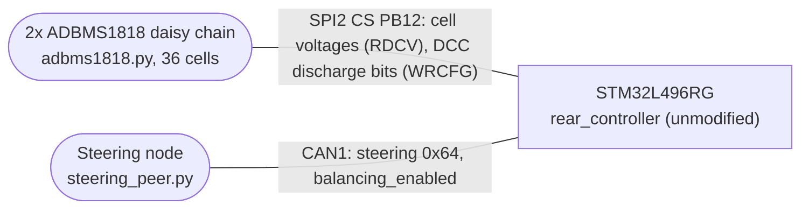
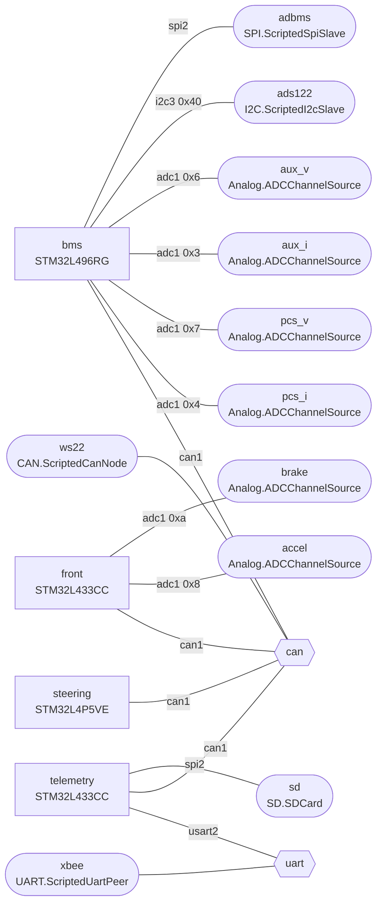

## Watch the BMS balance cells in a simulator

```sh
./demo build    # once: builds rear_controller with scons
./demo          # runs it on the simulated STM32L496 with the cell monitors and steering node (120 virtual s, about 4 min wall on a loaded laptop)
```


The GIF is sped up 20x.



The unedited `rear_controller` firmware, built for its STM32L496 preset, runs on pyrite, the Simantic simulator.
Two simulated ADBMS1818 cell monitors on SPI report 36 cells; cells 3 and 10 start high. The summary lines are decoded
from the readings the firmware pulls over SPI and the discharge bits it writes, so the numbers are what the bus carried.
Cell monitors, cell voltages and the steering node are Python models at transaction level, not electrical simulations,
and the timing is not measured against hardware. Pyrite is a proprietary simulator, not open source.

Needs `scons` (`pip install scons`), the Arm GNU toolchain, and `sim` 0.10.0 or newer on `PATH` (or `SIM=/path/to/sim`):

```sh
curl -fsSL https://simantic.com/install | sh
```

Known gap: this preset is a release build, so the firmware's own `MAX VOLTAGE` debug log is compiled out; the
summary lines come from the ADBMS bus instead. `firmware discharged:` lists the cells whose discharge (DCC) bits the
firmware had set since the previous line. The firmware stops each cell inside its own 10 mV deadband.

## This fork: the whole car in a simulator

This is Simantic's fork of Midnight Sun's firmware. It runs the car's real
firmware, unmodified apart from two lines, on simulated hardware: no boards, no bench.


The steering board's own display, 24 s into the drive scenario: the car accelerating through 52 km/h,
the pack sagging to 141 V at 19.5 A of discharge, cells at 3.920 V and 4.003 V.

**What runs:** four controllers on one simulated CAN bus, each on its own simulated STM32.

| Board | MCU | Firmware |
| --- | --- | --- |
| Rear controller (BMS) | STM32L496 | `projects/rear_controller` |
| Front controller | STM32L433 | `projects/front_controller` |
| Telemetry | STM32L433 | `projects/telemetry` |
| Steering, with its LTDC display | STM32L4P5 | `projects/steering` |

**The scenario**, as `sim graph --scenario sim/dashboard/car4.yaml` prints it. Square boxes are the
simulated MCUs running the firmware, rounded boxes are the modelled parts around them, and the hexagons
are the shared CAN bus and the radio UART:



**Configurations tried:**

| Configuration | Where | Firmware | Result |
| --- | --- | --- | --- |
| BMS alone, 2 x ADBMS1818 and a steering stand-in | `sim/scenario.yaml` | `rear_controller` | runs |
| Three boards on one CAN bus | `sim/car.yaml` | `rear_controller`, `front_controller`, `telemetry` | runs |
| Three boards with the drive scenario and dashboard | `sim/dashboard/car_dashboard.yaml` | same, steering stand-in | runs |
| Four boards with the drive scenario (the graph above) | `sim/dashboard/car4.yaml` | all four | runs |
| One real board against the simulator | NUCLEO-L433RC-P, branch `bench/nucleo-l433rc-p` | `blinky`, `front_controller`, `telemetry` | same tick on both, see below |

The four simulated configurations were last run for 10 virtual seconds each, with no faults, on a
build of Simantic's `sim` from 2026-11-15.

**Checked against a real STM32L433** (NUCLEO-L433RC-P over SWD): the board and the simulator are stopped
at the same points in the firmware and compared.

| Check | Board | Simulator |
| --- | --- | --- |
| `blinky`: tick at the 3rd LED toggle | 1001 | 1001 |
| `front_controller`: tick at the 3rd 1 Hz cycle | 2001 | 2001 |
| `front_controller`: 3-channel ADC with DMA, start to complete (core cycles) | 10,358 to 10,361 | 10,310 to 10,312 |
| `telemetry`: tick at the 3rd 1 Hz cycle, blank flash | 2001 | 2000 |

The bench branch moves four pins off PA5 to PA7 and puts CAN in loopback. On that Nucleo PA4 to PA7 control
its on-board regulator, and it has no CAN transceiver. The stock pin map stops the board in its first
1 Hz cycle, so do not flash the stock `front_controller` or `telemetry` on a NUCLEO-L433RC-P.

The parts around them are Python models in `sim/dashboard/`:
- **Cells:** the ADBMS1818 cell monitor (`adbms1818.py`).
- **Pack current:** the ADS122C14 current-sense ADC (`ads122c14.py`).
- **Motor controller:** the WS22 (`ws22_motor_controller.py`).
- **Radio:** the XBee on the telemetry board's UART2 (`xbee.py`). The firmware's own `xb_transmit.c`
  sends through it to Midnight Sun's telemetry dashboard.
- **On the boards:** the relay sense lines, the AUX power input, and telemetry's SD card.

All of them follow one drive scenario (`sim/dashboard/drive.csv`): park, accelerate to 60 km/h,
cruise, regen-brake, stop, every 100 s. Speed, pack and motor current, pack and cell voltage, and
state of charge therefore agree on the steering display.

**Replay your own drives:** `sim/dashboard/sd_to_drive.py` turns a log from the telemetry board's SD
card into that scenario, so the firmware re-drives a real run on the simulated boards:

```
python3 sim/dashboard/sd_to_drive.py /Volumes/SDCARD > sim/dashboard/drive.csv
```

**Run it** (needs `scons`, the Arm GNU toolchain, and Simantic's `sim` on PATH):

```
pip install scons -r requirements.txt
for p in rear_controller front_controller telemetry steering; do scons --platform=arm --project=$p; done
sim/dashboard/run.sh 600      # opens the steering display at http://localhost:8765/
```

The two changes to the firmware:
- **Persistence is off on the steering board** (`INCLUDE_PERSISTENCE 0` in
  `projects/steering/src/display.c`). `libraries/ms-common/inc/flash.h` gives every chip the
  STM32L433's flash layout, which doesn't fit the L4P5.
- **The radio is on** (`xb_transmit_init` in `projects/telemetry/src/main.c`), which upstream has
  commented out.
[`sim/dashboard/README.md`](sim/dashboard/README.md) has the details, the three-board variant and
how to attach the telemetry dashboard.

Everything below is Midnight Sun's README.

---

</br>
## Midnight Sun XVI Firmware
This repository contains all firmware for the [University of Waterloo](https://uwaterloo.ca/)'s [Midnight Sun Solar Rayce Car](http://www.uwmidsun.com/) team's car #24.

## Projects:
- Battery Management System (BMS)
- Power Distribution (PD)
- Centre Console (CC)
- Motor Controller Interface (MCI)
- Telemetry (TEL)
- Flash-over-CAN (BOOTLOADER)
- UART Controller (UART CLI)
- IMU Board
- CAN Autogen
- MPXE (Multi-Project x86 Emulation)

## Getting Started

To get started with the firmware, please refer to the [installation guide](https://uwmidsun.atlassian.net/wiki/spaces/Firmware/pages/60260353/Setup) for instructions on setting up the development environment and flashing the firmware onto the vehicle's embedded systems.

## License

This project is licensed under the MIT License. See the [LICENSE](LICENSE) file for more details.

