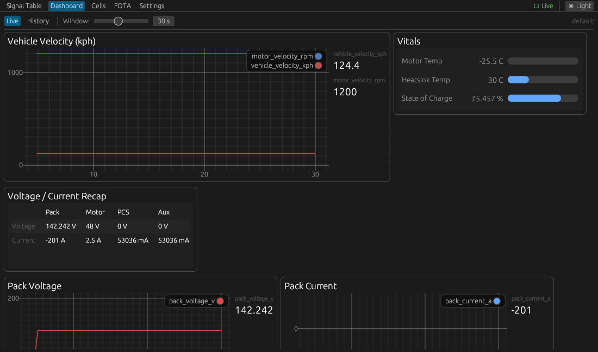
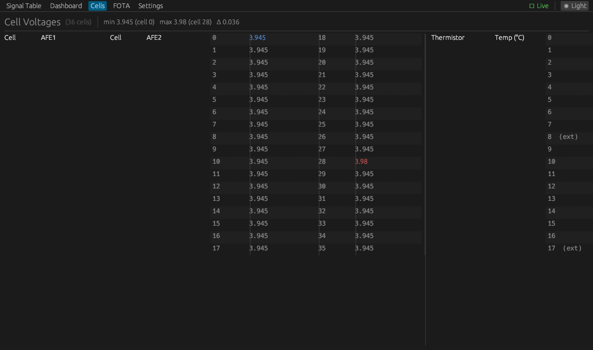
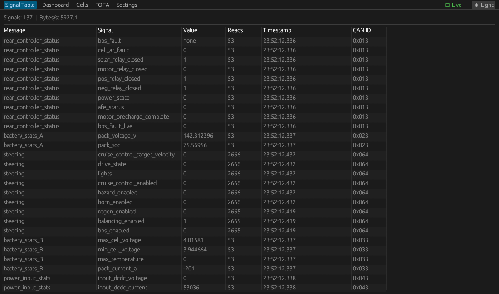

# The car on the telemetry dashboard

Midnight Sun's firmware runs on pyrite's simulated STM32s, and Midnight Sun's own telemetry
dashboard ([fwxvi_telemetry_client](https://github.com/uw-midsun/fwxvi_telemetry_client)) shows it live.





## What runs

| Part | What it is |
| --- | --- |
| rear_controller (BMS) | real firmware, simulated STM32L496RG |
| front_controller | real firmware, simulated STM32L433CC |
| telemetry | real firmware, simulated STM32L433CC |
| `adbms1818.py` | 2 daisy-chained ADBMS1818 AFEs on SPI2, 36 cells; cell 3 of AFE 1 at 3.95 V and cell 10 of AFE 2 at 3.98 V, the rest at 3.90 V |
| `steering_peer.py` | stand-in for the steering board (STM32L4P5, not simulated yet); sends `steering` with balancing enabled |
| `ws22_motor_controller.py` | WaveSculptor 22 motor controller; status frames every 100 ms, 1200 rpm |
| `xbee_bridge.py` | stand-in for the telemetry board's XBee forwarding (see below) |

All three boards and the peers share one CAN bus. The dashboard decodes every datagram with the
fwxvi CAN definitions: 137 signals, none unmatched.

## What the screenshots show

- **Dashboard:** WS22 at 1200 rpm and 124.4 km/h, pack at 142.24 V and -201 A, 75.46 % state of charge.
- **Cells:** the BMS firmware's readings of the simulated pack. Cell 28 (AFE 2 cell 10) is the high
  cell it is bleeding. The others read 3.945 V: 3.90 V plus the firmware's own
  `ADBMS1818_ADC_DC_OFFSET_10UV`.
- Files 06 to 08 are the same tabs about 60 s later. Values move between the two passes.

## Stand-ins and known gaps

- **XBee:** `projects/telemetry/src/main.c:132` has `xb_transmit_init` commented out, so the stock
  telemetry image sends nothing over XBee. With that line restored it still sent no bytes in a 20 s
  run, which is not explained yet. `xbee_bridge.py` does what `xb_transmit.c` does: it forwards CAN
  frames in the `datagram.h` framing (0xAA, ID big-endian, DLC, data, 0xBB) and re-encodes WS22
  frames into IDs 2039 to 2043 once a second.
- **Drive command is 0:** with no pedal calibration in flash, `brake_pedal.c` computes 0/0 and the
  filter holds NaN (`front_controller.c:79` ignores the `pedal_calib_read` return value).
- **Motor temperature reads -25.5 C:** the dashboard's `postprocess.yaml` negates that field.
- **PCS/Aux currents read 53036 mA:** not looked into.

## Run it

1. Build the three projects (`scons --project=rear_controller` with its STM32L496 preset;
   `front_controller` and `telemetry` with the default L433 preset).
2. Build the dashboard with `telemetry_client-pty.patch` applied (made against upstream
   a431966d). The patch lets it open a pty on macOS, where the serial library fails with "Not a
   typewriter", connect on start (`TELEMETRY_AUTOCONNECT`), and save screenshots of its own window
   (`TELEMETRY_SHOT_DIR`).
3. From the repository root:

```
SIM=/path/to/pyrite/sim DASH=/path/to/fwxvi_telemetry_client sim/dashboard/run.sh 600
```

The simulator is pyrite (Simantic). A `sim` build with the STM32L496 die is needed.
